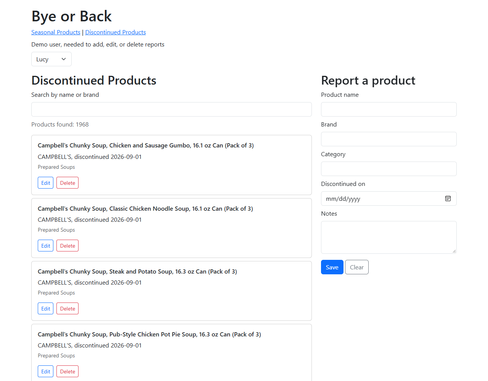

# Bye or Back

Web application for tracking discontinued and seasonal grocery products.

## Authors

Suk Jin Mun (Discontinued Products) and Alejandra Aimee Rivas Montes (Seasonal Products)

## Class link

[CS5610 Web Development, Northeastern University](https://johnguerra.co/classes/webDevelopment_online_fall_2026/)

## Objective

Shoppers search discontinued products by name or brand, see which seasonal products are available each month, and add, edit, or delete reports. Each author owns one MongoDB collection with full CRUD through Node, Express, and vanilla JavaScript.

## Screenshot

## Instructions to build

1. Install Node 22.12 or later and run `npm install`.
2. Copy `.env.example` to `.env` and set `MONGODB_URI` to the MongoDB Atlas connection string.
3. Run `npm run import:discontinued` once. It loads the 1,968 products in `data/discontinued-products.json`, taken from the April 2026 USDA FoodData Central Branded Foods release (products with a discontinued date, one per UPC).
4. Run `npm start`, open http://localhost:3000/discontinued.html, and choose a demo user to add, edit, or delete reports.
5. Run `npm run lint` to check the code with ESLint and Prettier.
